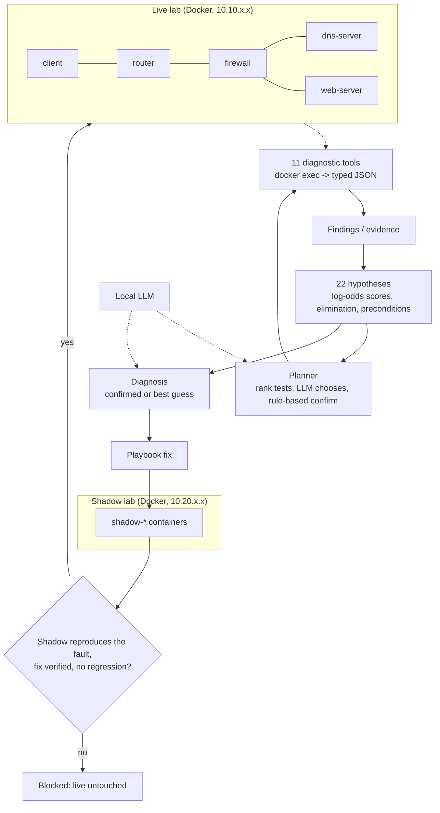

# ANTA: Autonomous Network Troubleshooting Agent

ANTA investigates failures in a reproducible Docker network the way a network engineer would. It keeps competing root-cause hypotheses, gathers evidence with real diagnostic tools, tests a fix on a shadow copy of the network, applies it only if it is safe, and proves the network works again.

Everything runs locally on one laptop (Intel i7-9750H, 16 GB RAM, RTX 2070 Max-Q) with a local LLM (qwen2.5:7b through Ollama). No cloud APIs and no paid services.


## How it works



Design rule: **the LLM reasons, tools state facts.** Tools return typed JSON, never raw terminal text. Confidence is computed from evidence by a scoring model; the LLM never sets it. The LLM chooses among ranked tests and writes explanations whose citations are validated against the evidence store.

## Fault types (hard cap of six)
| Layer | Fault | Injection |
|---|---|---|
| L2 | interface down | `ip link set down` |
| L3 | broken route | route deleted |
| L3 | link degradation | `tc netem` loss or delay |
| L4 | firewall block | iptables DROP / REJECT / chain policy |
| App | DNS failure | dnsmasq stopped or wrong answer |
| L7 | service failure | nginx stopped or returning HTTP 503 |

## Results
All numbers regenerate with `python3 -m experiments.final_report` (written to [docs/RESULTS.md](docs/RESULTS.md)).

| Held-out test split (19 scenarios, same local model) | Root-cause accuracy | 95% CI |
|---|---|---|
| LLM-only, no tools | 21% | 9-43% |
| ReAct with the same 11 tools | 42% | 23-64% |
| **ANTA** | **100%** | 83-100% |

* **Benchmark:** 61 automated scenarios (35 main, 16 on interface and link faults, 10 in a final held-out batch). ANTA is 61/61 on its own benchmark; see the methodology for what that does and does not show.
* **Final held-out batch** (10 scenarios across all six fault types, written last, run once on the tagged frozen code): ANTA 10/10 (95% CI 72-100%), ReAct 3/10, LLM-only 2/10.
* **Unseen fault types:** before the extension ANTA scored 0/16 on interface-down and packet-loss/delay faults (11 confidently wrong); after adding hypotheses it scored 16/16.
* **Remediation:** 45/45 faults repaired and verified with 0 regressions; 0 actions on healthy networks. The regression detector is self-tested against deliberately bad fixes.
* **Shadow gate:** 22/22 correct fixes applied, 22/22 wrong-diagnosis fixes blocked, 3/3 deliberately unsafe fixes blocked with the live network untouched (the same fixes caused damage when ungated). The shadow reproduced the live symptoms 47/47 times.
* **Ablations (51 scenarios):** the evidence model carries correctness, not the LLM. Ranking only (no LLM) is 100%; random test order is also 100% but needs 18.3 tool calls instead of about 10; `llama3.2:3b` is 100%. Removing the elimination rule drops accuracy to 96% and removing the precondition rule to 98% (with one confidently wrong answer). The LLM planner saves about 0.6 tool calls per diagnosis but costs about 14 seconds; its main value is the explanation with validated citations.

## Honest limitations
* The hypothesis table is hand-written domain knowledge for six fault families. 100% means "covers its library and generalises across devices, ports, mechanisms and wording within it", not general network troubleshooting.
* "No fault" means "no known fault found", not proof of health.
* Elimination-based proof costs tool calls: about 11 per diagnosis on average, and about 21 to confirm a healthy network.
* The shadow clones four state categories (routes, firewall rules, services, configs) plus interface and netem state. It is a shadow Docker stack, not a production digital twin.
* Small benchmark (n=19 on the headline split), single run per scenario at temperature 0.
* The LLM is not needed for correctness: ablations show the evidence model carries accuracy, and the LLM adds natural-language explanations (with validated citations) plus a small planning gain.
* Not compared against NIKA or SADE: different benchmarks, so no outperformance claim is made.

Full details: [docs/architecture.md](docs/architecture.md), [docs/evaluation_methodology.md](docs/evaluation_methodology.md).

## Quick start (WSL2 on Windows 11)
```bash
# Windows: install WSL2 (Ubuntu 24.04), Docker Desktop (WSL2 backend) and Ollama, then: ollama pull qwen2.5:7b
git clone <this repo> ~/ANTA && cd ~/ANTA
python3 -m venv .venv && source .venv/bin/activate
pip install -r requirements.txt
cd network/topology && docker compose up -d --build && cd ../..
cd network && ./verify_topology.sh && cd ..          # expect: 8 passed, 0 failed

python3 network/fault_injection/inject_firewall.py     # break the network
python3 -m remediation.safe_pipeline                    # diagnose, validate on the shadow, repair, verify
scripts/start_dashboard.sh                              # http://localhost:5173
```
The Ollama service must be reachable from WSL2 at `localhost:11434` (WSL mirrored networking, see docs/architecture.md).

## Repository
```
network/       lab (compose files, device image), fault injection, 11 diagnostic tools (+ 48-check gate)
agent/         LangGraph agent, hypothesis/evidence model, planner, verifier
remediation/   action playbook, shadow network, gated pipeline, evaluations, regression self-test
benchmark/     61 JSON scenarios, runner, evaluator (SQLite)
experiments/   baselines (LLM-only, ReAct), comparison, ablations, results
backend/       FastAPI server-sent-events API      frontend/   React + D3 dashboard
scripts/       start_lab, start_dashboard, demo_checklist, reproduce, run_ablations
docs/          architecture, evaluation methodology, results
```
