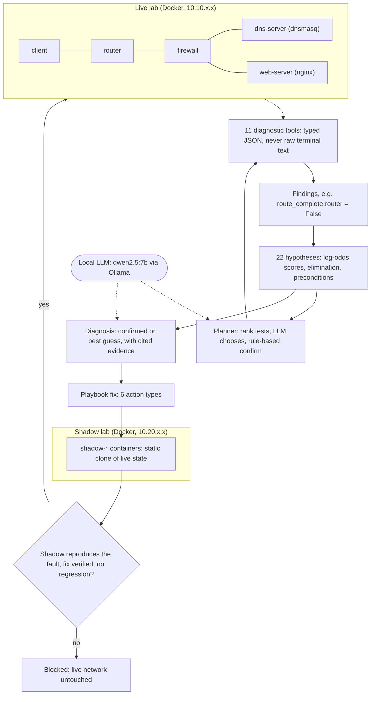
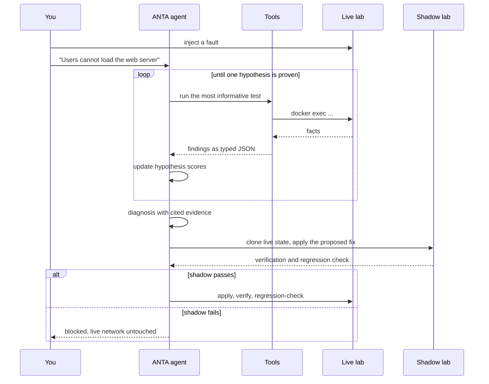

# ANTA: Autonomous Network Troubleshooting Agent

> A virtual network breaks. ANTA behaves like a network engineer: it investigates with real diagnostic tools, works out why it broke, proves a fix is safe on a shadow copy of the network, applies it, and verifies the network works again. Everything runs locally on one laptop. No cloud APIs, no paid services.

    

<p align="center">
</p>

## Contents
[Overview](#overview) · [Results at a glance](#results-at-a-glance) · [See it work](#see-it-work) · [How it works](#how-it-works) · [Fault types](#fault-types) · [Evaluation](#evaluation) · [Quick start](#quick-start) · [Usage](#usage) · [Repository layout](#repository-layout) · [Limitations](#limitations) · [Related work](#related-work) · [FAQ](#faq)

## Overview
Troubleshooting a network is slow and risky: you chase symptoms through layers, and a "fix" can make things worse. LLM agents can read logs, but they hallucinate network state, and nothing stops them from running a harmful command.

ANTA is built on four rules:

1. **The LLM reasons, tools state facts.** Every network fact comes from a diagnostic tool that returns typed JSON. The agent never sees raw terminal output.
2. **Evidence, not opinions.** Competing root-cause hypotheses are scored from tool findings. The LLM cannot set a confidence; it chooses which test to run next and writes an explanation whose citations are validated against the evidence store.
3. **Fail closed.** A fix reaches the live network only after the same fault has been reproduced on a shadow copy, repaired there, verified, and regression-checked.
4. **Reproducible.** A Docker lab, 61 JSON scenarios, one runner and a SQLite results database. Every number in this README regenerates from the code.

**What happens end to end:** a fault is injected into a five-container network, ANTA investigates (typically 6 to 11 tool calls, about 20 seconds with a local 7B model), names the root cause with cited evidence, proposes a fix from a playbook, clones the live state onto a shadow network, tests the fix there, applies it to the live network only if the shadow agrees, and proves the network is healthy again.

| Design in numbers | |
|---|---|
| Fault types (hard cap of six) | interface down, broken route, packet loss/delay, firewall block, DNS failure, service failure |
| Diagnostic tools | 11 (typed JSON) |
| Competing hypotheses | 22 (21 faults plus "no fault") |
| Diagnostic tests in the catalog | 26 |
| Fix actions | 6, each with explicit commands and rollbacks |
| Benchmark scenarios | 61 |
| Hardware | one laptop: i7-9750H, 16 GB RAM, RTX 2070 Max-Q (8 GB), Windows 11 + WSL2 |

## Results at a glance
All four systems use the same local model (qwen2.5:7b). The two baselines are given the same network description; ReAct also gets the same 11 tools.

**Held-out test split (19 scenarios)**

| System | Detection | Root-cause accuracy | 95% CI | Avg. tool calls | Avg. seconds |
|---|---|---|---|---|---|
| LLM-only (no tools) | 89% | 21% | 9-43% | 0 | 1.2 |
| ReAct (same tools) | 79% | 42% | 23-64% | 5.5 | 22.8 |
| **ANTA** | **100%** | **100%** | 83-100% | 11.4 | 22.9 |

**Final held-out batch** (10 scenarios across all six fault types, written last, run once on the tagged frozen code): LLM-only 20%, ReAct 30%, **ANTA 100% (95% CI 72-100%)**.

* **Healthy networks:** on the four healthy-network controls in the test split, ReAct reported a fault every time (0/4) and the LLM-only baseline got two of four. ANTA got four of four.
* **Unseen fault types:** before the extension, ANTA had no hypotheses for interface-down and packet-loss/delay faults and scored **0/16, with 11 confidently wrong answers**. After adding them it scored **16/16** (see [the protocol](#protocol-and-disclosures) for what that does and does not show).
* **Remediation:** **53/53** faults repaired and verified with **0 regressions**; 0 actions taken on 8 healthy networks. The regression detector is self-tested against deliberately bad fixes.
* **Shadow gate:** 22/22 correct fixes applied; **22/22 wrong-diagnosis fixes blocked**; **3/3 deliberately unsafe fixes blocked with the live network untouched** (the same three fixes caused a regression or failure when applied without the gate). The shadow reproduced the live symptoms 47/47 times.
* **What carries the accuracy:** the evidence model, not the LLM. See [ablations](#ablations).

These are results on a benchmark built around the same fault families as the hypothesis table. Read [Limitations](#limitations) before quoting them.

## See it work
<p align="center">
</p>

### Example 1: a firewall rule silently drops web traffic
The fault: `iptables -I FORWARD -p tcp --dport 80 -j DROP` on the firewall. The symptom given to ANTA is only: *"Users on the client cannot load the web server at web.anta.local."* An excerpt from a real run:

```text
[1] dns_query          LLM: "Separates H5 and H11"
    E2 dns web.anta.local via 10.10.3.10: resolved to 10.10.3.20
[2] svc_web            LLM: "Directly tests the leading hypotheses of service failure at web-server."
    E3 service web on web-server: running=True, port_open=True, local response=200
[3] ifaces_client      LLM: "Identify if client's interface is down or experiencing link degradation"
    E4 interfaces client: all up, no packet-loss/delay settings
[4] cap_firewall_http  LLM: "To determine if the HTTP request is being blocked at the firewall."
    E5 capture on firewall during client HTTP request: 3 packets; patterns: tcp_syn_unanswered, tcp_syn_retransmissions
[5] fw_firewall        rule-based: confirm the leading hypothesis with its most decisive test
    E6 firewall firewall: FORWARD: -p tcp -m tcp --dport 80 -j DROP (hits 3)

Diagnosis: firewall_block on firewall (L4)   [confirmed, 99%]   6 tool calls, 14.1 s
```

DNS resolves and the web service is healthy, so name resolution and the server are ruled out. The firewall capture shows SYNs arriving and never answered, and the rule inspection finds the exact `DROP`. The explanation the LLM writes cites only evidence that exists in the store: *"The evidence shows that the HTTP requests from clients are being dropped by the firewall, as indicated by the firewall rule and the lack of responses to the client requests."*

Then the gated repair:

```text
Proposed fix : Remove 1 blocking firewall rule(s) on firewall
    [firewall] iptables -D FORWARD -p tcp -m tcp --dport 80 -j DROP
Shadow       : fidelity (reproduces live symptoms) = True
               shadow fixed = True | regression = False []
DECISION     : applied - shadow validation passed
Live result  : fixed = True | regression = False
```

<p align="center">
</p>

### Example 2: a buggy fix is blocked
The same diagnosis, but the proposed fix is `iptables -F FORWARD`, which would also delete an unrelated harmless rule. The shadow network catches it, and the live network is never touched. Applied without the gate, the same fix damages the network:

```text
unsafe fix: overbroad_flush
  gated  : blocked_failed_shadow | live untouched=True
  ungated: fixed=True regression=True
           ["iptables:firewall: beyond declared change (+[] -['rule|FORWARD|-p tcp -m tcp --dport 8080 -j DROP'])"]
```

<p align="center">
</p>

### Example 3: the dashboard
`scripts/start_dashboard.sh` serves a live view at `http://localhost:5173`: the lab as a dot-matrix halftone whose dot density tracks hypothesis confidence, a hypothesis panel that collapses ruled-out causes, an investigation timeline that separates what the LLM chose (and why) from what the tools measured, a step-by-step shadow-gate panel, and a Results tab with the full benchmark.

<p align="center">
</p>

## How it works




### The lab
Five Linux containers on three bridge networks: `client - router - firewall - {dns-server (dnsmasq), web-server (nginx)}` (client 10.10.1.0/24, core 10.10.2.0/24, servers 10.10.3.0/24). Containers carry `NET_ADMIN`, static IPs and static routes set by an entrypoint script. Docker NAT is disabled and default routes are removed, so the lab cannot reach the host or the internet while running. (Docker's `internal: true` networks were rejected: Docker's own anti-spoofing rules drop routed traffic between bridges.)

### The tool layer
Eleven tools run real Linux commands inside the containers and return typed JSON (Python dataclasses). The LLM never receives terminal output.

| Tool | Returns |
|---|---|
| `get_topology` | nodes, L2 segments, IP assignments |
| `get_interface_status` | link state, IPv4, MAC, packet-loss/delay (netem) settings |
| `get_route_table` | destination, gateway, interface, metric |
| `get_arp_table` | IP, MAC, interface, state |
| `ping` | reachability, loss, RTT, failure mode, which device sent an ICMP error |
| `traceroute` | hops with IP, RTT, timeout, ICMP flags |
| `inspect_dns` | resolved, answer IP, latency, error type (timeout, refused, unreachable, ...) |
| `inspect_firewall` | chains, policies, rules with hit counters |
| `capture_packets` | tcpdump while a probe runs: packet counts and patterns (SYN unanswered, RST seen, ...) |
| `check_service` | process running, port open, local response (HTTP code or DNS rcode) |
| `get_logs` | normalised entries from container, nginx and dnsmasq logs |

A `namespace()` switch points the same tools, verifier and remediation code at the shadow network.

### The evidence model
A **test** calls one tool and turns its JSON into **findings** such as `route_complete:router = False`. Each of the 22 hypotheses carries a table of predictions: a finding, the value it expects, and a likelihood ratio.

| Hypothesis: "the router is missing its route to the server subnet" | Expected | Strength |
|---|---|---|
| `route_complete:router` | False | decisive (LR 30) |
| `iface_up:router` | True | decisive **precondition** (LR 30) |
| `unreach_from:client->web-server` | router | LR 8 |
| `reach:client->dns-server` | False | LR 3 |
| `dns_resolves` | False | LR 2 |

* **Scoring (log-odds):** an anomalous finding that matches a prediction raises the score; any finding that contradicts a prediction lowers it; a healthy reading that matches a "stays healthy" prediction is neutral. Healthy readings are never evidence *for* a hypothesis.
* **Elimination:** a hypothesis whose decisive prediction (LR >= 10) is observed to be false is eliminated, and confidence is renormalised over the survivors.
* **Preconditions:** a missing route is only the root cause if the interface under it is up. ANTA verifies that before concluding, so it does not blame a route for what is really a down interface.
* **Conclusion rule:** leader >= 90%, a decisive supporting finding, no decisive contradiction, no unverified precondition. **"No fault" is proven by elimination**: nothing anomalous was seen and every fault hypothesis was decisively ruled out. It means *no known fault found*, not proof of health.

### The planner and the agent graph
The agent is a LangGraph state machine: `init -> decide -> (plan -> act -> update -> decide)* -> conclude`.

* **Ranking:** each untested test is scored by how well it splits the surviving hypotheses.
* **LLM:** chooses among the top six candidates and gives a one-line reason; an invalid choice falls back to the top-ranked test.
* **Confirm step:** once a leader passes 90% without decisive proof, a rule runs its most decisive test (or the unverified precondition).
* 26 tests in the catalog, budget of 30 steps. The final explanation is written by the LLM and its evidence citations are validated against the store; invalid citations are repaired.

### Remediation
A playbook maps each diagnosis to one of six actions, planned from fresh tool facts and never written by the LLM:

| Action | What it does |
|---|---|
| restore routes | re-adds the missing static route or default route via the right next hop |
| remove blocking rules | deletes only the DROP/REJECT rules that block http, dns or ping (harmless rules are left alone) and resets DROP chain policies |
| start service | starts the stopped nginx or dnsmasq |
| restore config | copies the known-good config from the repo and reloads (fixes HTTP 503 and wrong DNS answers) |
| bring interface up | brings the link up and restores the static routes Linux drops when a link goes down |
| clear netem | removes packet-loss/delay settings |

After applying a fix: three scenario checks (ping, HTTP 200, DNS), a full health fingerprint, and a **state-snapshot diff** over routes, firewall rules, services, configs and interface state. Any change the action did not declare counts as a **regression**.

### The shadow network gate
A second Compose project (`shadow-*`, 10.20.x.x). At proposal time the live state (firewall rules and policies, routes, service state, configs, interface state and netem settings) is replayed onto it with IPs translated: a **static clone**, never kept in sync.

1. **Fidelity:** the shadow must show the same configuration-level anomalies as live (for probabilistic faults such as packet loss, symptom-level findings are random, so only configuration-level findings are compared). Otherwise the verdict is `blocked_inconclusive`.
2. Apply the proposed fix **to the shadow only**.
3. Verify and regression-check there. If the fix does not restore service or changes anything undeclared: `blocked_failed_shadow`.
4. Only then apply to live, verify again, and regression-check again.

A block leaves the live network untouched, and ANTA confirms that by diffing the live state before and after.

### The dashboard
FastAPI runs each job in a thread and streams its events (server-sent events). The React + D3 front end draws the topology, hypothesis confidence, the evidence timeline and the gate stepper live, and reads the benchmark database for the Results tab. The hero is a dot-matrix (LED halftone) rendering of the lab drawn on a canvas every frame.

## Fault types
| Layer | Fault | How it is injected |
|---|---|---|
| L2 | interface down | `ip link set <iface> down` |
| L3 | broken route | route deleted on a router, endpoint or default route |
| L3 | link degradation | `tc netem` packet loss or delay |
| L4 | firewall block | iptables DROP or REJECT (tcp, udp, icmp) or a chain policy set to DROP |
| App | DNS failure | dnsmasq stopped, or the record points at the wrong address |
| L7 | service failure | nginx stopped, or returning HTTP 503 |

## Evaluation
### Benchmark
61 JSON scenarios (an injected fault, symptom wording, ground truth, required evidence), run by one automated pipeline: reset, inject, run a system, evaluate, log to SQLite.

| Split | n | Purpose |
|---|---|---|
| dev | 16 | tuned on |
| test | 19 | headline split (see disclosures) |
| stress | 10 | interface-down and loss/delay faults the first agent had no hypotheses for |
| stress_test | 6 | fresh scenarios of those two types, held out before the extension |
| final | 10 | final held-out batch across all six fault types, run once on the frozen code |

Tiers: seen faults, rephrased symptoms, variants (other devices, ports, mechanisms), controls (healthy network, harmless firewall rules) and unknown fault types. An example scenario:

```json
{
  "id": "s03",
  "description": "Firewall drops tcp/80",
  "tier": "A_seen",
  "split": "dev",
  "symptom": "Users on the client cannot load the web server at web.anta.local.",
  "topology": "standard_5node",
  "injected_fault": {"type": "firewall_block", "device": "firewall", "mechanism": "iptables",
                     "chain": "FORWARD", "protocol": "tcp", "port": 80, "action": "DROP"},
  "ground_truth": {"device": "firewall", "layer": "L4", "cause": "firewall_block",
                   "evidence_required": ["fw_has_drop:firewall"]},
  "remediation": {"action": "remove_firewall_rule", "device": "firewall"},
  "verification_tests": ["ping_success", "http_200", "dns_resolves"]
}
```

**Metrics:** detection, root-cause accuracy (cause and device), device and layer localisation, evidence quality (cited findings include the required ones), tool calls, seconds, confidently-wrong rate, remediation success, regression rate. Confidence intervals are Wilson 95%.

**Baselines** (same model, same label vocabulary):
* **LLM-only:** the network description and the symptom, no tools.
* **ReAct:** thought, tool call, observation loop over the same 11 tools with JSON observations; 15 tool calls.

### Results
**All 35 main scenarios:** LLM-only 20%, ReAct 34%, ANTA 100% (CI 90-100%).

**Interface and link faults (16 scenarios)**

| Agent | Detection | Root-cause accuracy | Confidently wrong | Tool calls |
|---|---|---|---|---|
| Before the extension (no hypotheses for these faults) | 69% | 0/16 | 11 | 12.9 |
| After the extension | 100% | 16/16 | 0 | 8.0 |

**Remediation (verified and regression-checked)**

| Fault type | Scenarios | Fixed | Regressions |
|---|---|---|---|
| broken route | 9 | 9 | 0 |
| DNS failure | 6 | 6 | 0 |
| firewall block | 14 | 14 | 0 |
| interface down | 9 | 9 | 0 |
| link degradation | 10 | 10 | 0 |
| service failure | 5 | 5 | 0 |
| **all** | **53** | **53** | **0** |

**Shadow gate**

| Check | Result |
|---|---|
| Correct fixes applied (live fixed, no regression) | 22/22 |
| Wrong-diagnosis fixes blocked, live untouched | 22/22 |
| Unsafe fixes blocked, live untouched | 3/3 |
| The same unsafe fixes without the gate: regression or failure | 3/3 |
| Shadow reproduced the live symptoms | 47/47 |

The wrong-diagnosis fixes are ineffective rather than harmful; the harmful-fix evidence is the three crafted unsafe fixes, which is a small sample.

### Ablations
All 51 main and interface/link scenarios, switched by environment variables:

| Variant | Root-cause accuracy | Confidently wrong | Tool calls | Seconds |
|---|---|---|---|---|
| Full agent (LLM planner, qwen2.5:7b) | 100% | 0 | 9.8 | 20.7 |
| Ranking only, no LLM | 100% | 0 | 10.4 | 6.7 |
| Random test order, no LLM | 100% | 0 | 18.3 | 19.2 |
| LLM planner on llama3.2:3b | 100% | 0 | 10.9 | 19.8 |
| Without the elimination rule | 96% | 0 | 11.8 | 7.9 |
| Without the precondition rule | 98% | 1 | 10.3 | 6.5 |

The evidence model carries correctness; the LLM does not. Ranking alone is as accurate, random order costs about 80% more tool calls, and a 3B model works as well. The LLM planner saves about 0.6 tool calls per diagnosis but costs about 14 seconds; its real contribution is the natural-language explanation with validated citations. Without elimination, the two ICMP-drop firewall scenarios fail; without preconditions, an interface-down fault is confidently called a route fault.

### Protocol and disclosures
1. 25 scenarios were written and the first full run scored 52% overall, because of a bug I introduced (the "no fault" hypothesis got a score bonus from every healthy reading). The misses also exposed missing hypotheses and a ground-truth bug in two control scenarios.
2. Fixes were tuned on **dev only**. Four scenarios whose misses motivated fixes were moved from test to dev, and ten fresh scenarios were added before the test split was run once on the frozen agent.
3. Nine of the 19 test scenarios had been run once before tuning.
4. **Stress test:** the agent without hypotheses for interface-down and loss/delay faults scored 0/16. Its results were archived before any change.
5. The extension's first pass on the held-out s46-s51 was 5/6 correct with no confidently wrong answers. It also broke two in-library scenarios, which led to the elimination rule. After that fix: 6/6. **That fix was informed by two of those scenarios**, so the clean held-out evidence is the first-pass 5/6 and the final batch.
6. **Final held-out batch** (s52-s61): written last and run once with both baselines on the code tagged `anta-final-frozen`. `git diff anta-final-frozen -- agent network` is empty. With n=10, a perfect score only supports "at least about 72%".

### Bugs the evaluation caught
* The "no fault" bias that scored 52%.
* An incomplete lab reset after a config-poisoning test: only 4 of 15 correct fixes passed the gate. Reset now restores the known-good configs.
* Packet-loss faults made the shadow fidelity check fail closed, because few-probe symptoms are random. Fidelity now uses configuration-level findings for those faults.
* The extension broke two old scenarios, caught by the regression run and fixed with the elimination rule.
* ARP noise counted as traffic in packet captures. Captures are now filtered to the probe's own traffic.
* Two overlapping evaluation jobs corrupted each other's faults (a healthy control was diagnosed with the neighbouring scenario's fault). Runs now take a lab lock.

## Quick start
**Prerequisites:** Windows 11 + WSL2 (Ubuntu 24.04) or Linux; Docker (Desktop with the WSL2 backend, or Engine); [Ollama](https://ollama.com) with `qwen2.5:7b` (about 4.7 GB); Python 3.12; Node.js 20+ for the dashboard. A GPU is recommended: it was developed on an RTX 2070 Max-Q (8 GB). CPU-only works but is slower.

```bash
ollama pull qwen2.5:7b                       # on the machine that runs Ollama

git clone https://github.com/<your-username>/ANTA.git ~/ANTA && cd ~/ANTA
python3 -m venv .venv && source .venv/bin/activate
pip install -r requirements.txt

cd network/topology && docker compose up -d --build && cd ../..   # the build needs internet once; the running lab is offline
cd network && ./verify_topology.sh && cd ..                         # expect: 8 passed, 0 failed
```

**WSL2 with Ollama on Windows:** WSL must reach Ollama on `localhost:11434`. Enable mirrored networking by adding `[wsl2]` and `networkingMode=mirrored` to `%UserProfile%\.wslconfig`, then run `wsl --shutdown`. Check with `curl http://localhost:11434` (it should say "Ollama is running").

First run:
```bash
python3 network/fault_injection/inject_firewall.py     # break the network
python3 -m remediation.safe_pipeline                   # diagnose, validate on the shadow, repair, verify
```

Dashboard:
```bash
cd frontend && npm install && cd ..
scripts/start_dashboard.sh                             # http://localhost:5173 (API on :8000)
```

## Usage
**Break and fix from the CLI**
```bash
python3 network/fault_injection/inject_firewall.py     # also inject_route.py, inject_dns.py, inject_service.py
python3 -m agent.anta "Users on the client cannot load the web server at web.anta.local."   # diagnose only
python3 -m remediation.safe_pipeline                   # diagnose + shadow-gated repair (--dry-run, --no-apply)
python3 network/fault_injection/restore_firewall.py    # undo a fault by hand
```
Any of the 61 scenarios, including the interface and packet-loss faults, can be run from the dashboard's scenario picker.

**Call the diagnostic tools directly** (from `network/`)
```bash
cd network
python3 -m tools list
python3 -m tools ping client 10.10.3.20
python3 -m tools inspect_firewall firewall
```

**Benchmark and evaluations** (from the repo root, venv active; run only one at a time, a lab lock refuses overlapping runs)
```bash
python3 -m benchmark.make_scenarios                              # regenerate the 61 scenario files
python3 -m benchmark.runner --system anta --split test           # also: llm_only, react; splits dev, stress, stress_test, final
python3 -m remediation.run_eval --split final                    # diagnose, fix, verify, regression-check
python3 -m remediation.run_gate_eval --split test                # wrong-diagnosis and unsafe-fix evidence for the shadow gate
python3 -m experiments.compare                                   # system comparison with confidence intervals
python3 -m experiments.final_report                              # writes docs/RESULTS.md
scripts/run_ablations.sh                                         # all ablation variants (about 1.5 hours)
scripts/reproduce.sh                                             # everything, several hours (--quick skips the slowest parts)
```

**Environment switches:** `ANTA_MODEL` (for example `llama3.2:3b`), `OLLAMA_URL`, `ANTA_PLANNER` (`llm`, `ranked`, `random`), `ANTA_EXPLAIN` (`off` disables explanations), `ANTA_ABLATE` (`no_elimination`, `no_preconditions`).

## Tests
```bash
cd network && python3 -m tools.gate       # 48 checks: all 11 tools on the healthy network and under each fault
cd .. && python3 -m remediation.selftest  # regression detector: 4 cases (over-broad, collateral damage, does nothing, correct)
python3 -m benchmark.runner --inject-only # every scenario injects and resets cleanly
scripts/demo_checklist.sh                 # pre-flight check: Ollama, Docker, containers, lab health, LLM
```

## Repository layout
```text
network/        lab (compose files, device image), fault injection, 11 diagnostic tools (+ 48-check gate)
agent/          LangGraph agent, hypothesis and evidence model, planner, verifier
remediation/    fix playbook, shadow network, gated pipeline, evaluations, regression self-test
benchmark/      61 JSON scenarios, runner, evaluator (SQLite), lab lock
experiments/    baselines (LLM-only, ReAct), comparison, ablations, results database
backend/        FastAPI server-sent-events API
frontend/       React + D3 dashboard
scripts/        start_lab, start_dashboard, demo_checklist, reproduce, run_ablations, final_run
docs/           architecture, evaluation methodology, generated results, images
```
More detail: [docs/architecture.md](docs/architecture.md), [docs/evaluation_methodology.md](docs/evaluation_methodology.md), [docs/RESULTS.md](docs/RESULTS.md) (generated from `experiments/results/anta_bench.sqlite`).

## Limitations
* **The hypothesis table is hand-written domain knowledge** for six fault families, and the benchmark was written around the same families. 100% means "covers its library and generalises across devices, ports, mechanisms and wording within it", not general network troubleshooting. A fault outside the library is the case the stress test measured: the earlier agent was confidently wrong 11 times out of 16.
* **"No fault" means "no known fault found",** not proof of health.
* **Elimination-based proof costs tool calls:** about 11 per diagnosis on average, and about 21 to confirm a healthy network.
* **The LLM is not needed for correctness.** The ablations show the evidence model carries accuracy; the LLM adds explanations and a small planning gain.
* **The shadow is a Docker stack, not a production digital twin.** It clones routes, firewall rules, services, configs, interface state and netem settings, and a fidelity check blocks the fix if the shadow does not reproduce the fault.
* **Small benchmark and a single lab topology.** n=19 on the headline split, n=10 on the final batch, one run per scenario at temperature 0, so variance across LLM sampling is not measured.
* **Not compared against published systems.** The benchmarks differ, so no outperformance claim is made.

## Related work
NIKA is a large public benchmark for LLM-based network troubleshooting. SADE proposes a structured diagnostic policy that separates evidence acquisition from hypothesis commitment. Both stop at diagnosis. ANTA applies the same separation, adds validated remediation with a shadow network, and runs entirely on local hardware with a local LLM. It is not benchmarked against their published numbers.

## FAQ
**Is 100% suspicious?** The benchmark is built around the same fault families as the hypothesis table, so it shows coverage and generalisation within the library, not open-ended troubleshooting. The README therefore reports the protocol, the contamination disclosures, a stress test where the agent without the right hypotheses scored 0/16 and was confidently wrong 11 times, and a final held-out batch run once on frozen code.

**What does the LLM actually do?** It chooses among ranked tests and writes the explanation. Correctness comes from the evidence model, and the ablations show a 3B model works equally well.

**Why not train a model?** The faults are deterministic and checkable with tools. An interpretable evidence model is auditable, needs no training data, and runs offline.

**How is hallucination prevented?** Tools return typed JSON, the LLM cannot set confidence, its citations are validated against the evidence store, and every fix is gated.

**Can it run without a GPU?** Yes. The ranking-only variant does not call the LLM at all and is as accurate; the LLM only adds planning and explanations.

## License
MIT. See [LICENSE](LICENSE).

## Author
Naman Alex Xavier.
